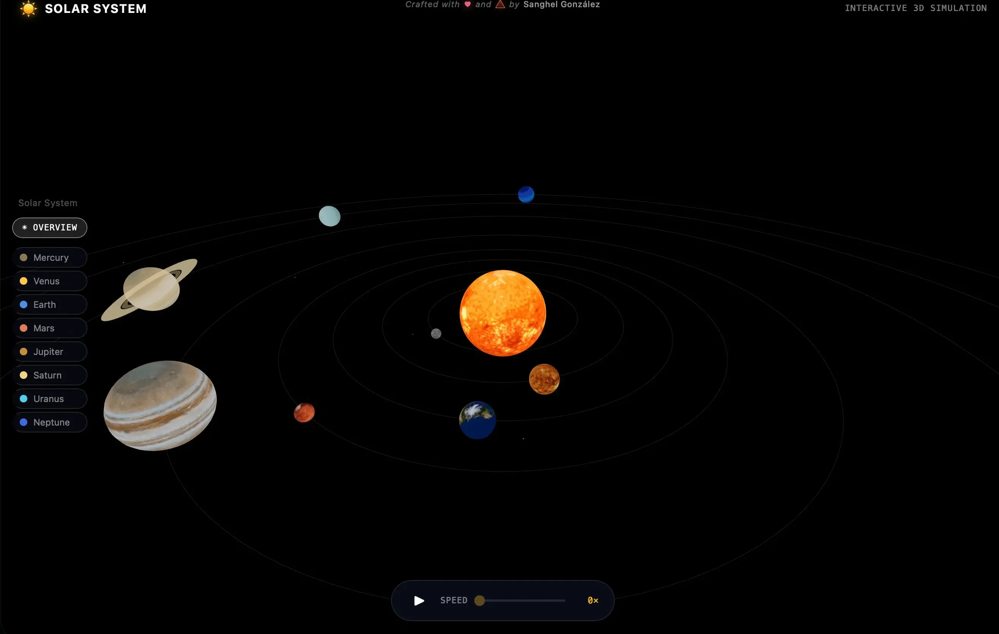

<!-- markdownlint-disable-next-line MD041 -->
<a id="top"></a>

<div align="center">



<h1>Solar System 3D</h1>

<p><strong>An interactive 3D simulation of the Solar System — fly to every planet and its moons, in real time.</strong></p>

<p>
<a href="https://github.com/Sanghel/solar-system-3d/releases"></a>
<a href="https://solar-system-3d-opal.vercel.app"></a>


<a href="LICENSE"></a>
</p>

<p>
<a href="https://solar-system-3d-opal.vercel.app"><strong>Live demo</strong></a> &bull;
<a href="#features"><strong>Features</strong></a> &bull;
<a href="#quick-start"><strong>Quick start</strong></a> &bull;
<a href="CHANGELOG.md"><strong>Changelog</strong></a>
</p>

<br/>

<p>
Textbook diagrams flatten the Solar System into a row of circles.
<strong>Here you can orbit it, speed time up or freeze it, and fly the camera to any planet to see
its moons, its real axial tilt and the numbers that make it unique.</strong>
</p>

<br/>



<br/><br/>

<sub><strong>BUILT WITH</strong></sub>

<br/>


<br/><br/>

</div>

<div align="center"></div>

## Features

<table>
<tr>
<td width="50%" valign="top">

### 🪐 Fly to any planet
Click a planet (or pick it from the sidebar) and the camera flies to it with a smooth ease-out, then
follows it along its orbit, keeping the same angle and distance.

</td>
<td width="50%" valign="top">

### 🌙 13 moons
Luna, the Galilean moons, Titan, Triton and more orbit their planets with real textures. Orbit rings and
name tooltips appear when their planet is selected.

</td>
</tr>
<tr>
<td valign="top">

### 📐 Real astronomy
Axial tilt from real values (Earth 23.4°, Uranus 97.8°) and retrograde rotation for Venus and Uranus.
Each planet shows its diameter, temperature, distance, orbital speed and a fun fact.

</td>
<td valign="top">

### ⏱️ Time controls
Pause, play and scale the simulation from 0.1× to 10×.

</td>
</tr>
<tr>
<td valign="top">

### 📱 Mobile controls
A floating action button opens a slide-up planet drawer, or shows and hides the info panel without
losing the selection.

</td>
<td valign="top">

### ⚡ Fast by design
Vendor chunk split and lazy-loaded UI, textures preloaded early and moon textures deferred, fewer polygons
on mobile and a capped pixel ratio.

</td>
</tr>
</table>

<div align="center"></div>

## Tech stack

| Technology | Version | Role |
|---|---|---|
|  | 19 | UI layer and component model |
|  | 6 | Type safety across the codebase |
|  | 0.183 | 3D rendering engine |
|  | 9 | React renderer for Three.js |
|  | 10 | Helpers for React Three Fiber |
|  | 8 | Dev server and production bundler |
|  | 10 | Package manager |
|  | — | Hosting and analytics |

<div align="center"></div>

## Quick start

> **Prerequisites:** Node.js v20.19+ or v22.12+ and pnpm v10+.

```bash
git clone https://github.com/Sanghel/solar-system-3d.git
cd solar-system-3d
pnpm install
pnpm dev          # http://localhost:5173
```

| Command | Description |
|---|---|
| `pnpm dev` | Development server with HMR |
| `pnpm build` | Type-check and build for production |
| `pnpm preview` | Preview the production build locally |
| `pnpm lint` | Run ESLint |

<div align="center"></div>

## How it's built

<details>
<summary><strong>Project structure</strong></summary>

```
solar-system-3d/
├── public/
│   └── textures/           # Planet, Sun and moon texture maps
├── src/
│   ├── components/
│   │   ├── Scene/          # 3D: Canvas, Sun, Planet, Satellite, Orbit, Lights, CameraController
│   │   └── UI/             # Header, PlanetInfo, PlanetNavigation, PlanetDrawer, TimeControl, FAB…
│   ├── context/            # SimulationContext: time scale and pause state
│   ├── data/planets.ts     # Planet and moon data (size, distance, tilt, texture, fun facts…)
│   ├── hooks/              # useCameraAnimation, usePlanetSelection, useIsMobile
│   ├── styles/global.css   # Design tokens (CSS custom properties)
│   ├── types/              # Planet TypeScript types
│   └── utils/              # Orbit helpers
└── vite.config.ts
```

</details>

<details>
<summary><strong>Performance</strong></summary>

The app is split into chunks so the browser caches vendor libraries independently of app code:

| Chunk | Gzip size | Notes |
|---|---|---|
| `vendor-r3f` | ~304 kB | Three.js + R3F + Drei — long-term cached |
| `index` | ~6 kB | App entry point |
| `PlanetInfo` | ~1 kB | Lazy-loaded on first planet selection |
| `PlanetNavigation` | ~1 kB | Lazy-loaded on first render |
| `TimeControl` | ~1 kB | Lazy-loaded on first render |

Also: `React.memo` on components with stable props, `useTexture.preload()` for planet textures (moon
textures wait until a planet is selected), 32/24 sphere segments on desktop/mobile, `dpr={[1, 2]}`, and a
pre-React loading indicator for an instant first paint.

</details>

<details>
<summary><strong>Workflow and conventions</strong></summary>

`feature/<issue>-<description>` → PR into `develop` → phase PR into `main`, which deploys to Vercel.

- Components use **named exports**
- Lazy-loaded components resolve through `.then(m => ({ default: m.Component }))`
- CSS custom properties live in `src/styles/global.css`

</details>

<div align="center"></div>

## Credits & license

Planet, Sun and moon textures from [Solar System Scope](https://www.solarsystemscope.com/textures/) (CC BY 4.0) and USGS/NASA (public domain) — see [`public/textures/README.md`](public/textures/README.md).

Code under the [MIT](LICENSE) license © Sanghel González.

<div align="center">

<sub>Crafted by <a href="https://github.com/Sanghel"><strong>Sanghel González</strong></a> · <a href="https://sanghel-portfolio.vercel.app">Portfolio</a></sub>

<br/>

<a href="#top">↑ Back to top</a>

</div>
